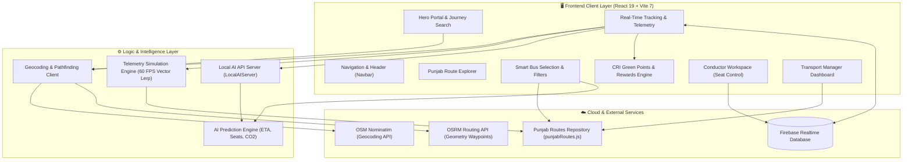
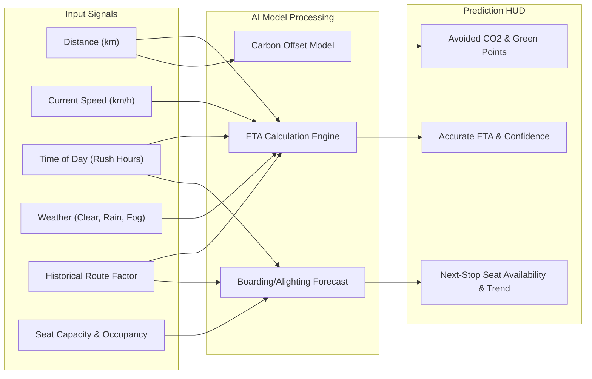
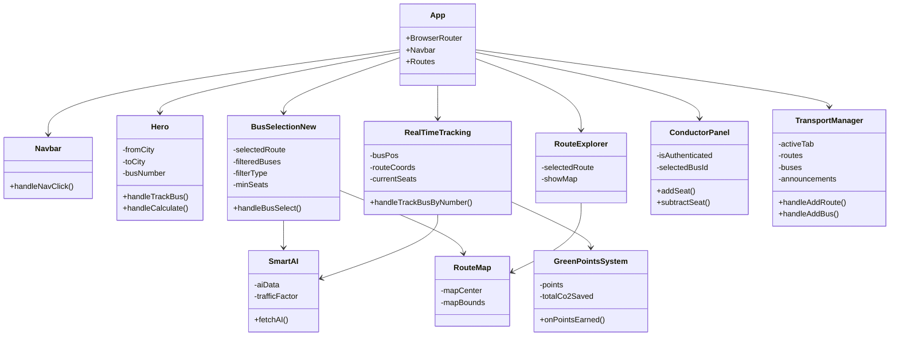

# 🚌 DigiMARG - Architecture & Comprehensive System Documentation

> **Mobility Assistance for Reliable Governance**  
> *An Intelligent Public Transit Monitoring, Geospatial Fleet Tracking, and Eco-Gamification Platform for the Punjab Region and Beyond.*

---

## 📑 Table of Contents

1. [Executive Summary & System Overview](#1-executive-summary--system-overview)
2. [High-Level System Architecture](#2-high-level-system-architecture)
3. [Technology Stack & Dependency Matrix](#3-technology-stack--dependency-matrix)
4. [Repository Structure & Codebase Inventory](#4-repository-structure--codebase-inventory)
5. [Core Subsystems & Feature Breakdown](#5-core-subsystems--feature-breakdown)
   - [5.1 Passenger Portal & Journey Search](#51-passenger-portal--journey-search)
   - [5.2 Real-Time Geospatial Tracking Engine](#52-real-time-geospatial-tracking-engine)
   - [5.3 AI-Powered Prediction Engine](#53-ai-powered-prediction-engine)
   - [5.4 Carbon Reduction Initiative (CRI) & Gamification](#54-carbon-reduction-initiative-cri--gamification)
   - [5.5 Conductor Mobile Workspace](#55-conductor-mobile-workspace)
   - [5.6 Enterprise Transport Manager Dashboard](#56-enterprise-transport-manager-dashboard)
6. [Component Hierarchy & Data Flow](#6-component-hierarchy--data-flow)
7. [Database Schema & Firebase Security Rules](#7-database-schema--firebase-security-rules)
8. [Telemetry, Simulation & Math Models](#8-telemetry-simulation--math-models)
9. [Deployment & Infrastructure Configuration](#9-deployment--infrastructure-configuration)
10. [Codebase Audit & Strategic Recommendations](#10-codebase-audit--strategic-recommendations)

---

## 1. Executive Summary & System Overview

**DigiMARG** (*Mobility Assistance for Reliable Governance*) is a full-stack, real-time public transit tracking and intelligent fleet management platform. Built to modernize and digitize regional transit across Punjab, India, DigiMARG addresses three core pillars:

1. **Passenger Empowerment**: Provides commuters with real-time bus locations on interactive maps, route discovery, live seat availability, and intelligent ETA predictions adjusted for traffic and weather.
2. **Environmental Accountability (CRI)**: Introduces the *Carbon Reduction Initiative*, a gamified sustainability engine that calculates avoided carbon emissions ($\text{g CO}_2$) when passengers choose buses over private cars, rewarding users with redeemable Green Points and leaderboard status.
3. **Operational Governance**: Equips transport authorities with role-based access control (RBAC) tools—including an intuitive on-bus conductor seat management interface and an executive fleet manager suite for route scheduling, vehicle dispatching, and broadcast passenger announcements.

---

## 2. High-Level System Architecture

DigiMARG implements an event-driven, decoupled client-side architecture supported by cloud databases, open GIS services, and simulated AI microservices.



### Architectural Key Characteristics
- **Zero-Backend-Cold-Start**: The system operates with Firebase Realtime Database for state synchronization and client-side deterministic algorithms for intelligent prediction modeling.
- **Resilient Fallback Design**: If live GPS hardware is unavailable or in offline/demo mode, the integrated vector interpolation simulator smoothly animates bus movement along real geographic coordinates at ~50ms intervals.
- **Progressive Enhancement**: Leaflet layers and maps dynamically adapt to route changes with automatic coordinate bounding calculations (`fitBounds`).

---

## 3. Technology Stack & Dependency Matrix

The DigiMARG frontend is built upon a modern React 19 ecosystem bundled with Vite:

| Category | Technology | Version | Purpose in DigiMARG |
| :--- | :--- | :--- | :--- |
| **Framework** | [React](https://react.dev/) | `^19.1.1` | Core UI library with modern Hooks (`useMemo`, `useRef`, `useState`, `useEffect`) |
| **Build Tooling** | [Vite](https://vitejs.dev/) | `^7.1.2` | High-speed ESM bundler and HMR local dev environment |
| **Styling** | [Tailwind CSS](https://tailwindcss.com/) | `^4.1.12` | Next-generation utility-first styling with `@tailwindcss/vite` |
| **Routing** | [React Router DOM](https://reactrouter.com/) | `^7.8.2` | Declarative client-side routing, route parameters, and query string synchronization |
| **Animations** | [Framer Motion](https://www.framer.com/motion/) | `^12.23.12` | Fluid page transitions, stagger animations, and floating background aesthetics |
| **Interactive Maps** | [Leaflet](https://leafletjs.com/) & [React-Leaflet](https://react-leaflet.js.org/) | `^1.9.4` / `^5.0.0` | OpenStreetMap tile rendering, custom SVG marker pins, dynamic polyline route paths |
| **Realtime Data** | [Firebase Web SDK](https://firebase.google.com/) | `12.2.1` | Realtime Database connections for bus positions and fleet status |
| **Iconography** | [Lucide React](https://lucide.dev/) & [React Icons](https://react-icons.github.io/react-icons/) | `^0.542.0` / `^5.5.0` | High-fidelity icons (FontAwesome, Feather, Lucide) |
| **Visual Effects** | [React Confetti](https://github.com/alampros/react-confetti) | `^6.4.0` | Celebration particle animations when users hit Green Point milestones |
| **CSS-in-JS** | [Styled Components](https://styled-components.com/) | `^6.1.19` | Dynamic styling support for specific animated UI elements |

---

## 4. Repository Structure & Codebase Inventory

```
d:\DigiMARG\
├── .gitignore                      # Git ignore patterns
├── database.rules.json             # Firebase Realtime Database authorization rules
├── eslint.config.js                # ESLint flat configuration (React Hooks, React Refresh)
├── firebase.js                     # Firebase app & database client initialization
├── firebase.json                   # Firebase hosting and project deployment metadata
├── index.html                      # HTML5 entrypoint with favicon and root mount point
├── netlify.toml                    # Netlify deployment rules with SPA redirect fallback
├── package.json                    # Project metadata, scripts, and dependencies
├── vercel.json                     # Vercel SPA rewrite configuration
├── vite.config.js                  # Vite configuration with Tailwind CSS v4 plugin
├── README.md                       # Comprehensive markdown documentation & demo guide
│
├── data/
│   └── punjabRoutes.js             # Structured database of Punjab routes, stops, and buses
│
├── services/
│   ├── aiApiServer.js              # Local AI server abstraction simulating cloud endpoints
│   ├── aiPredictionService.js      # Core algorithms for ETA, seat forecasting, and CO2
│   └── localAIService.js           # Lightweight development mocks for AI endpoints
│
├── utils/
│   └── testDataGenerator.js        # Mathematical route interpolation & GPS simulator
│
├── public/
│   ├── bus.png / bus.jpg           # Vehicle branding visuals
│   ├── busroute.png                # Visual route diagram
│   ├── gold.jpeg                   # Eco reward coupon asset
│   ├── logo.png                    # DigiMARG circular brand badge
│   ├── punjab.svg                  # Regional geographic vector asset
│   └── vite.svg                    # Vite asset
│
├── src/
│   ├── App.jsx                     # Central route definitions and navigation wrapper
│   ├── App.css / index.css         # Tailwind & Leaflet global stylesheet imports
│   ├── main.jsx                    # React 19 root mounting file
│   │
│   ├── components/
│   │   ├── Navbar.jsx              # Responsive header with smooth anchor navigation
│   │   ├── Hero.jsx                # Landing hero, journey search, CRI calculator, coupons
│   │   ├── BusDetails.jsx          # Route-level bus schedule and seat gauge list
│   │   ├── BusInfo.jsx             # Individual bus telemetry profile with route timeline
│   │   ├── AdminHome.jsx           # Administrative hub with operational KPI counters
│   │   ├── AdminLogin.jsx          # Mock authentication gateway for conductors & managers
│   │   ├── ConductorPanel.jsx      # Mobile-optimized seat increment/decrement dashboard
│   │   ├── TransportManager.jsx    # Enterprise fleet, route, and announcement suite
│   │   ├── ProtectedRoute.jsx      # Role-based route protection guard
│   │   └── NotFound.jsx            # 404 error page with navigation fallback
│   │
│   └── assets/                     # React vector graphics
│
├── RealTimeTracking.jsx            # Live map telemetry, Leaflet integration, and HUD
├── RouteExplorer.jsx               # Visual catalog of famous Punjab transit corridors
├── RouteMap.jsx                    # Self-contained Leaflet route visualization component
├── SmartAI.jsx                     # AI Insights card widget (ETA, crowd, environmental impact)
├── GreenPointsSystem.jsx           # Distance-based CRI point accumulator & leaderboard
├── BusSelectionNew.jsx             # Advanced multi-filter bus search & booking interface
└── BusSelection.jsx                # Baseline bus search component
```

> [!NOTE]
> `src/App.jsx` imports top-level feature components (`RealTimeTracking.jsx`, `RouteExplorer.jsx`, `BusSelectionNew.jsx`) directly from the workspace root.

---

## 5. Core Subsystems & Feature Breakdown

### 5.1 Passenger Portal & Journey Search
- **Entry File**: [`src/components/Hero.jsx`](src/components/Hero.jsx)
- **Features**:
  - Dual Search Modal: Allows users to search either by **Source + Destination City** or directly by **Vehicle Registration Number** (e.g., `PB20480001`).
  - Form validation: Routing immediately dispatches to `/track?busNumber=...` or `/buses?from=...&to=...`.
  - Feature Showcase: Animated cards highlighting real-time tracking, stop accuracy, and delay alerts.
  - Quick Admin Shortcut: Unobtrusive portal link for transit personnel.

### 5.2 Real-Time Geospatial Tracking Engine
- **Primary Component**: [`RealTimeTracking.jsx`](RealTimeTracking.jsx)
- **Mapping Foundation**: [`react-leaflet`](package.json#L22) with OpenStreetMap.
- **Workflow**:
  ```mermaid
  sequenceDiagram
      autonumber
      actor User as Commuter
      participant RTT as RealTimeTracking.jsx
      participant FB as Firebase RTDB (buses/{id})
      participant OSRM as OSRM Project API
      participant Sim as testDataGenerator.js

      User->>RTT: Mounts with ?busNumber=PB20480001
      RTT->>RTT: Resolves Bus & Route from punjabRoutes.js
      alt Real Data Available
          RTT->>FB: Attach onValue listener to buses/PB20480001
          FB-->>RTT: Stream [lat, lng, speed, timestamp]
      else Test Mode / No Hardware
          RTT->>Sim: Initialize simulateBusMovement(routeCoords)
          loop Every 50ms (Vector Lerp)
              Sim-->>RTT: Emit updated [lat, lng, heading, speed]
          end
      end
      RTT->>OSRM: Query driving path between stops
      OSRM-->>RTT: Polyline coordinate array
      RTT->>User: Render bus marker, route polyline, ETA, and stops
  ```
- **Key Capabilities**:
  - **Dynamic Route Waypoints**: Connects to the public OSRM API (`router.project-osrm.org`) to render real road curvatures instead of straight Euclidean lines.
  - **Auto-Bounding**: Incorporates a sub-component [`FitBounds`](RealTimeTracking.jsx#L115-L121) to center and zoom the camera whenever route coordinates change.
  - **Custom GeoJSON Markers**: Distinct visual markers for origin, stops, landmarks, user geolocation, and heading-oriented bus icons.

---

### 5.3 AI-Powered Prediction Engine
- **Services**: [`services/aiPredictionService.js`](services/aiPredictionService.js) and [`services/aiApiServer.js`](services/aiApiServer.js)
- **UI Widget**: [`SmartAI.jsx`](SmartAI.jsx)

The AI Engine calculates three vital predictive metrics:



#### Mathematical Formulas:
1. **Intelligent ETA**:
   $$\text{Base Time (min)} = \left(\frac{\text{Remaining Distance}}{\text{Speed}}\right) \times 60$$
   $$\text{Traffic Delay} = \text{Traffic Factor} \times T_{\text{multiplier}} \times W_{\text{multiplier}} \times 2$$
   $$\text{ETA} = \max(1, \text{Base Time} + \text{Traffic Delay} + \text{Historical Factor})$$
   *Where $T_{\text{multiplier}} = 1.5$ during morning rush (07:00–09:00) and $1.3$ during evening rush (17:00–19:00).*

2. **Seat Availability Forecast**:
   $$\text{Predicted Next Seats} = \text{Current Seats} - \text{Predicted Boarding} + \text{Predicted Drop}$$
   Categorizes trend as `Increasing`, `Stable`, or `Decreasing` with confidence scoring.

---

### 5.4 Carbon Reduction Initiative (CRI) & Gamification
- **UI Engine**: [`GreenPointsSystem.jsx`](GreenPointsSystem.jsx) & [`src/components/Hero.jsx`](src/components/Hero.jsx#L229-L245)
- **Core Concept**:
  Private car transit emits $\approx 120-150\text{ g CO}_2/\text{km}$. A shared bus emits only $\approx 40\text{ g CO}_2/\text{passenger}\cdot\text{km}$ (and $0\text{ g}$ for electric buses).
  $$\Delta \text{CO}_2 = (\text{Emission}_{\text{car}} - \text{Emission}_{\text{bus}}) \times \text{Distance}$$
  $$\text{Green Points} = \left\lfloor \frac{\Delta \text{CO}_2 (\text{grams})}{100} \right\rfloor$$
- **Gamified Elements**:
  - **Live Point Accumulator**: Increments points dynamically as the tracked bus covers distance.
  - **Confetti Explosion**: Triggers full-screen confetti upon point generation.
  - **Eco Warriors Leaderboard**: Ranks commuters against peers.
  - **Coupon Store**: Exchange points for verified coupons (e.g., Swiggy, Zomato, Uber, Flipkart).

---

### 5.5 Conductor Mobile Workspace
- **Component**: [`src/components/ConductorPanel.jsx`](src/components/ConductorPanel.jsx)
- **Target Persona**: On-board bus conductors using smartphone browsers.
- **Workflow**:
  1. Conductor selects their vehicle / assigned route from the dropdown.
  2. Submits route-specific passkey (e.g., `amr-jal-001` for Amritsar to Jalandhar, `ldh-chd-002` for Ludhiana to Chandigarh).
  3. Gains access to touch-friendly, large **[+]** and **[-]** buttons to update passenger count on the fly.
  4. Real-time feedback showing total capacity, occupied seats, and remaining seats.

---

### 5.6 Enterprise Transport Manager Dashboard
- **Component**: [`src/components/TransportManager.jsx`](src/components/TransportManager.jsx)
- **Target Persona**: Fleet Operations Directors, Route Planners, and Regional Transport Officers.
- **Dedicated Management Tabs**:
  1. **Dashboard & KPIs**: Visual metrics for Total Buses (25), Active Fleet (18), Active Routes (10), Total Passengers (2,847), On-Time Performance (87%), and Fuel Efficiency (92%). Includes recent trip activity logs and route revenue rankings.
  2. **Route Planner**: View, create, update, and deprecate routes; configure stop counts and assign active buses.
  3. **Fleet Manager**: Register vehicles, configure seat capacities, and bind buses to specific routes.
  4. **Public Announcements**: Broadcast regional transit bulletins with priority tags (`Normal`, `High`, `Urgent`) visible to commuters.

---

## 6. Component Hierarchy & Data Flow



---

## 7. Database Schema & Firebase Security Rules

### Firebase Realtime Database Structure

```json
{
  "buses": {
    "PB20480001": {
      "busNumber": "PB20480001",
      "name": "Heritage Express",
      "lat": 31.6340,
      "lng": 74.8723,
      "speed": 42,
      "heading": 180,
      "routeId": "PB001",
      "currentSeats": 35,
      "totalSeats": 50,
      "status": "Running",
      "lastUpdated": 1793635000000
    }
  },
  "routes": {
    "PB001": {
      "name": "Amritsar → Wagah Border",
      "distance": "28.3 km",
      "stops": [
        { "name": "Amritsar Bus Stand", "lat": 31.6340, "lng": 74.8723 },
        { "name": "Golden Temple", "lat": 31.6200, "lng": 74.8765 }
      ]
    }
  },
  "users": {
    "$userId": {
      "name": "Prakhar",
      "greenPoints": 500,
      "co2SavedGrams": 50000
    }
  },
  "ai_predictions": {
    "PB001": {
      "congestionIndex": 1.2,
      "avgDelayMinutes": 4.5
    }
  }
}
```

### Database Security Rules ([`database.rules.json`](database.rules.json))

```json
{
  "rules": {
    "users": {
      "$userId": {
        ".read": "auth != null && auth.uid == $userId",
        ".write": "auth != null && auth.uid == $userId"
      }
    },
    "buses": {
      ".read": true,
      ".write": "auth != null"
    },
    "routes": {
      ".read": true,
      ".write": "auth != null"
    },
    "ai_predictions": {
      ".read": true,
      ".write": "auth != null"
    }
  }
}
```

> [!IMPORTANT]
> The security rules permit **unauthenticated read access** to bus telemetry and route catalogs, ensuring fast, frictionless map rendering for anonymous passengers, while restricting write mutations strictly to authenticated drivers, conductors, and dispatchers.

---

## 8. Telemetry, Simulation & Math Models

When hardware GPS trackers are not actively broadcasting, [`utils/testDataGenerator.js`](utils/testDataGenerator.js) provides a physics-based simulation of vehicle motion along coordinates:

```javascript
// High-fidelity GPS movement along waypoints
const tickRate = 50; // 20 updates/second
const speed = 0.0005; // degree displacement per tick

// Vector direction calculation
const dx = targetPos[0] - currentPos[0];
const dy = targetPos[1] - currentPos[1];
const dist = Math.sqrt(dx * dx + dy * dy);

// Heading calculation for rotating marker icon
const heading = Math.atan2(dy, dx) * (180 / Math.PI);
```

### Haversine Distance Formulation
To calculate real distances between GPS coordinate tuples:
$$a = \sin^2\left(\frac{\Delta \phi}{2}\right) + \cos(\phi_1)\cos(\phi_2)\sin^2\left(\frac{\Delta \lambda}{2}\right)$$
$$c = 2 \cdot \text{atan2}\left(\sqrt{a}, \sqrt{1-a}\right)$$
$$d = R \cdot c \quad (R = 6371\text{ km})$$

---

## 9. Deployment & Infrastructure Configuration

DigiMARG is pre-configured for instant zero-configuration deployment across leading cloud edge platforms:

### 1. Netlify Deployment ([`netlify.toml`](netlify.toml))
```toml
[build]
  publish = "dist"
  command = "npm run build"

[[redirects]]
  from = "/*"
  to = "/index.html"
  status = 200
```
- Directs all client-side routes (e.g. `/track`, `/buses`, `/admin`) to the single-page application entry point `index.html`.

### 2. Vercel Deployment ([`vercel.json`](vercel.json))
```json
{
  "rewrites": [
    {
      "source": "/(.*)",
      "destination": "/index.html"
    }
  ]
}
```

### 3. Local Development Setup
```bash
# 1. Clone repository & install dependencies
npm install

# 2. Run local development server
npm run dev

# 3. Build optimized production bundle
npm run build

# 4. Preview local production build
npm run preview
```

---

## 10. Codebase Audit & Strategic Recommendations

Based on our comprehensive line-by-line review of the codebase, here are strategic architectural observations and recommended refinements:

### 1. Structural Consolidation
* **Observation**: Several core components (`RealTimeTracking.jsx`, `RouteExplorer.jsx`, `RouteMap.jsx`, `SmartAI.jsx`, `GreenPointsSystem.jsx`, `BusSelectionNew.jsx`) reside at the project root rather than within `src/pages/` or `src/components/`.
* **Recommendation**: Migrate root-level JSX components into standard directories:
  - `src/pages/` $\rightarrow$ `RealTimeTracking.jsx`, `RouteExplorer.jsx`, `BusSelection.jsx`.
  - `src/components/` $\rightarrow$ `SmartAI.jsx`, `GreenPointsSystem.jsx`, `RouteMap.jsx`.
  - Remove duplicate root files (`BusDetails.jsx`, `BusInfo.jsx`, `BusSelection.jsx`).

### 2. Environment Variable Hygiene
* **Observation**: In [`firebase.js`](firebase.js#L4-L12), Firebase configuration keys are hardcoded in source.
* **Recommendation**: Relocate credentials to a `.env.local` file using Vite conventions (`VITE_FIREBASE_API_KEY`, `VITE_FIREBASE_PROJECT_ID`, etc.).

### 3. Conductor State Synchronization
* **Observation**: Conductor panel adjustments currently mutate local component state (`state.seats`).
* **Recommendation**: Bind the `addSeat()` and `subtractSeat()` handlers directly to Firebase Realtime Database `update(ref(db, ...))` so commuter maps reflect seat changes across the network instantaneously.

### 4. Admin Authentication Hardening
* **Observation**: In [`src/components/AdminLogin.jsx`](src/components/AdminLogin.jsx#L50-L59), credentials are hardcoded strings evaluated against `localStorage`.
* **Recommendation**: Transition from mock `localStorage` tokens to Firebase Authentication (`signInWithEmailAndPassword`) with Firebase Custom Claims for RBAC (`role: 'conductor' | 'manager'`).

---
*DigiMARG — Transforming public transportation through technology, sustainability, and transparency.*
